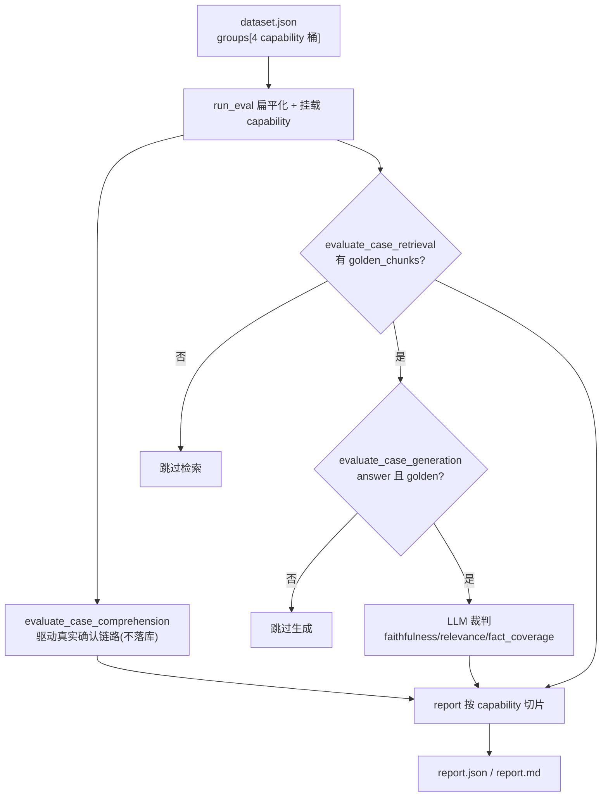

## 用户需求
将 RAG 评测测试集从"按业务场景（scenario）组织"重构为"按 RAG 四大能力组织"，并重做结构与全新编写覆盖均衡的 case，补齐缺失的评测与报告维度。

## 产品概述
评测集与评测引擎围绕 RAG 的四个核心能力构建：理解能力（意图识别/实体抽取/澄清与拒答决策）、检索能力（基于正确主体的相关内容召回）、生成能力（基于检索上下文的忠实、相关、完整作答）、边界能力（库外/库内无内容/闲聊/敏感等越界场景的稳健处理）。测试集采用四类能力分桶结构，报告首次支持按能力切片出分。

## 核心特性
- 测试集重做为 `groups` 四桶结构（comprehension / retrieval / generation / boundary），每桶约 12–16 条均衡全新 case，冗余保留 `capability` 字段便于扁平工具。
- 理解能力补齐真实评测路径：驱动线上主体确认链路，断言 is_chitchat、确认 item_names、clarify/refuse 决策，产出意图/实体/行为准确率与综合 comprehension_score。
- 检索/生成沿用现有黄金锚点与 LLM 裁判，仅结构迁移，不重复造轮子；边界能力以行为断言为判分。
- 报告主维度改为按 capability 切片（理解/检索/生成/边界各出分），保留按书次维度与 leakage 失败标记。
- lint 校验同步支持分桶结构、capability 枚举，并对 comprehension/boundary 放宽 golden_chunks 必需约束。


## 技术栈
- 语言/运行：Python 3.11+，uv 管理（已锁定 `uv.lock`，torch 2.5.1+cu121 已恢复）。
- 复用：`evaluation/evaluate_retrieval.py`、`evaluate_generation.py`、`metrics.py` 不变；`app/rag/query/item_name_confirm_service.py` 的真实确认链路被评测直接复用。
- 依赖：Milvus 可达（检索/理解评测均需命中 item_name 与 chunks 集合）。

## 实施方案
**策略**：将测试集从扁平 `cases` 重构为 `meta.groups[4]` 分桶；评测编排对每条 case 先跑理解评测（驱动真实确认链路但不落库历史），再按是否含 `golden_chunks` 跑检索、按 `answer`+`golden` 跑生成；报告主维度从 type/book 改为 capability。

**关键决策**：
1. **理解评测直接复用 `item_name_confirm_service` 子流程**（rewrite+extract → candidates → select → apply），而非另写一套意图逻辑，保证测的是"系统真实理解能力"。为避免历史库污染，调用时不走 `save_user_message`，用合成 session_id 在内存 state 上跑。
2. **golden_chunks 必须复用已校验的真实 chunk_uid**：现有 dataset 中基于 10 本 kb_books 核对过的 `chunk_uid` 直接迁移到全新 retrieval/generation case，确保 exact 模式有效；对确需全新内容的检索 case，用新增 `mint_golden.py` 向线上 KB 查询候选 uid 供人工/LLM 策展，严禁凭空编造 uid。
3. **comprehension/boundary 多数 case 不依赖 golden_chunks**（仅断言意图/行为），故 lint 与 run_eval 需放宽：这类 case 允许缺 `golden_chunks`，但仍须 `expected_intent`/`expected_item_names`/`expected_behavior` 作为期望基线。
4. **检索/生成评测零改动**：其读取字段（golden_chunks/hard_facts/answer_keypoints/forbidden）保持不变，仅 case 被重新分桶组织，向后兼容。

**性能与可靠性**：理解评测每条多一次 LLM 改写调用，属必要开销、量级可接受（case 数 ~50）；retrieval soft 模式会批量 embed（已用 BGE-M3 归一化余弦，O(n·m) 可控）；验证优先 `uv run` 避免解释器错配；dataset.json 重写前保留既有 `.bak` 备份。

## 实施注意
- 不要改动 `evaluate_retrieval.py`/`evaluate_generation.py` 的字段契约，保持 case 字段名一致即可直接复用。
- `apply_item_name_result` 对 clarify/refuse/chitchat 会写 `state["answer"]`；理解评测据此反推 `expected_behavior` 是否命中，无需额外字段。
- 重写 dataset.json 时 `case_id` 改为能力前缀（CMP-/RET-/GEN-/BND-）保证全局唯一；lint 的重复 id 检查继续生效。
- 验证阶段用 `--limit` 小批量先跑通，避免 50 条全量 LLM 调用耗时过长；先 `lint_dataset.py` 再 `run_eval.py`。

## 架构设计


## 目录结构
```
evaluation/
├── dataset.json                 # [REWRITE] 四能力分桶结构；comprehension/boundary 行为断言 case（多无 golden），retrieval/generation 复用已校验 golden chunk_uid，全新编写覆盖均衡
├── evaluate_comprehension.py    # [NEW] 理解能力评测：复用 item_name_confirm_service 真实子流程(不落库)，断言 is_chitchat/确认 item_names/clarify/refuse，产出 intent/entity/behavior 准确率与 comprehension_score
├── run_eval.py                  # [MODIFY] 扁平化 groups 并挂载 capability；每条先跑理解评测，再按 golden_chunks/answer 跑检索与生成
├── report.py                    # [MODIFY] aggregate_results 新增 by_capability 主切片，保留 by_book 次维度与 leakage 失败标记；markdown 增加"按能力"章节
├── lint_dataset.py              # [MODIFY] 支持 groups 遍历、capability 枚举；comprehension/boundary 允许缺 golden_chunks；保留 chunk_uid 格式/库内一致性校验
├── mint_golden.py               # [NEW] 辅助脚本：对线上 KB 查询候选 chunk_uid/content_type，供全新 retrieval/generation case 策展真实锚点
├── evaluate_retrieval.py        # [REUSE] 不变，字段契约兼容
├── evaluate_generation.py       # [REUSE] 不变，字段契约兼容
├── metrics.py                   # [REUSE] 不变
└── report.json / report.md      # [OUTPUT] 按能力切片的最终报告
```

## 关键代码结构
```python
# evaluation/evaluate_comprehension.py （接口级，仅签名与契约）
def _run_confirm_chain(query: str, history: list[dict] | None = None) -> dict:
    """复用 item_name_confirm_service 真实子流程（不落库历史），
    返回 {is_chitchat, confirmed, options, answer, rewritten_query}。"""

def evaluate_case_comprehension(case: dict, session_id: str = "__eval__") -> dict:
    """驱动真实主体确认链路并断言理解能力；
    返回 intent_accuracy / entity_accuracy / behavior_accuracy / comprehension_score。"""
```

```json
// evaluation/dataset.json 顶层结构（节选）
{
  "meta": {
    "version": "2.0.0",
    "kb_books": ["三体", "人类简史", "小王子", "撒哈拉的故事", "明朝那些事儿",
                 "活着", "蛤蟆先生去看心理医生", "解忧杂货店", "追风筝的人", "非暴力沟通"],
    "capability_legend": {
      "comprehension": "意图识别/实体抽取/澄清与拒答决策",
      "retrieval": "基于正确主体的相关内容召回",
      "generation": "基于检索上下文的忠实、相关、完整作答",
      "boundary": "库外/库内无内容/闲聊/敏感等越界场景稳健处理"
    }
  },
  "groups": [
    {"capability": "comprehension", "description": "...", "cases": [ {"case_id": "CMP-001", "capability": "comprehension", ...} ]},
    {"capability": "retrieval",     "description": "...", "cases": [ {"case_id": "RET-001", "capability": "retrieval", ...} ]},
    {"capability": "generation",    "description": "...", "cases": [ {"case_id": "GEN-001", "capability": "generation", ...} ]},
    {"capability": "boundary",      "description": "...", "cases": [ {"case_id": "BND-001", "capability": "boundary", ...} ]}
  ]
}
```

